# DIMA Accounting

<p align="center">
  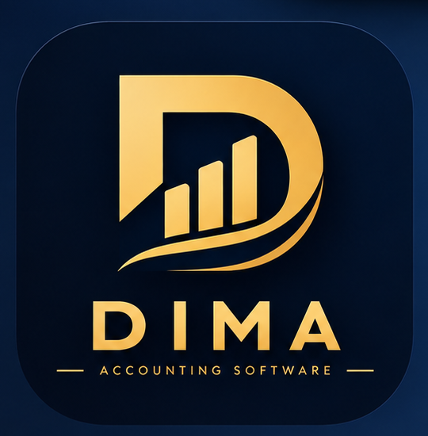
</p>

<p align="center">
  <strong>Persian-first desktop accounting for small businesses — sales, purchases, inventory, treasury, and double-entry bookkeeping in one app.</strong>
</p>

<p align="center">
  <a href="https://github.com/OmidDevAi/DIMA-Accounting/releases/latest">
    
  </a>
  
  
  
  
</p>

<p align="center">
  <a href="https://github.com/OmidDevAi/DIMA-Accounting/releases/latest"><strong>Download for Windows</strong></a>
  ·
  <a href="#screenshots">Screenshots</a>
  ·
  <a href="#run-from-source">Run from source</a>
  ·
  <a href="https://github.com/OmidDevAi/DIMA-Accounting/issues">Report a problem</a>
</p>

<div dir="rtl">

**DIMA Accounting** یک نرم‌افزار حسابداری دسکتاپ فارسی‌زبان برای فروشگاه‌ها و کسب‌وکارهای کوچک است: فروش و خرید، انبار، مشتریان، خزانه و چک، و حسابداری دوبل — همه در یک برنامه‌ی ویندوزی با پایگاه‌داده‌ی محلی SQLite. رابط کاربری راست‌به‌چپ است و داده‌ها روی همان رایانه‌ی شما ذخیره می‌شوند.

</div>

## Overview

DIMA Accounting is a Windows desktop application built with Python, PyQt6, and SQLite. It combines day-to-day store operations — selling, purchasing, stock, customers, cash boxes, and checks — with double-entry accounting, so operational entries are reflected in journal entries, the trial balance, profit & loss, the balance sheet, and the general ledger.

The interface is Persian and right-to-left. The codebase separates core services (`core/`), business logic (`modules/`), and the desktop interface (`ui/`), and ships with an automated test suite.

> **Project status:** Version 1.0.0 is the first public Windows release. The application is under active development; the [known limitations](#known-limitations) section lists behavior that is not yet complete. Read the [data and security notes](#data-and-security) before using it with real business records.

## Screenshots

<p align="center">
  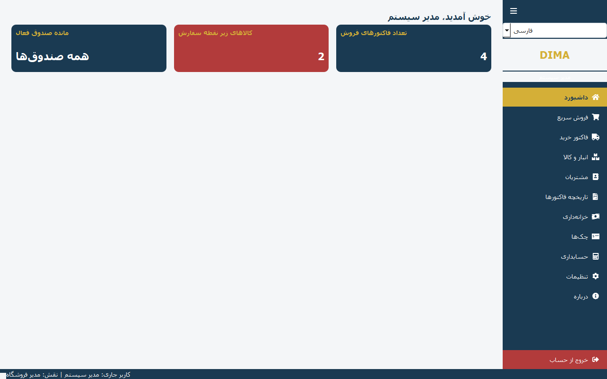
</p>

| Sales | Purchase |
| --- | --- |
| 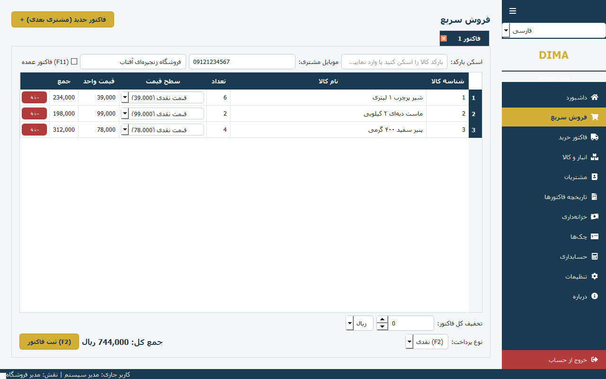 | 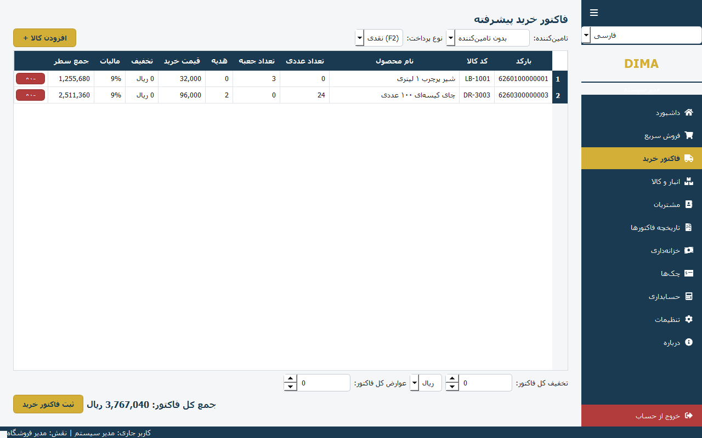 |

| Invoices | Inventory |
| --- | --- |
| 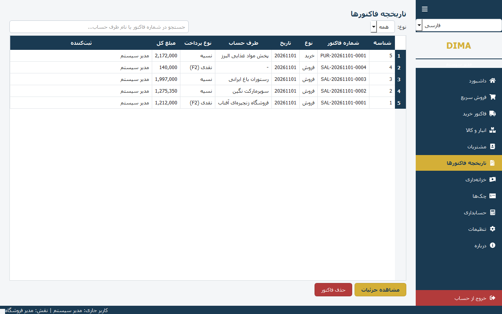 | 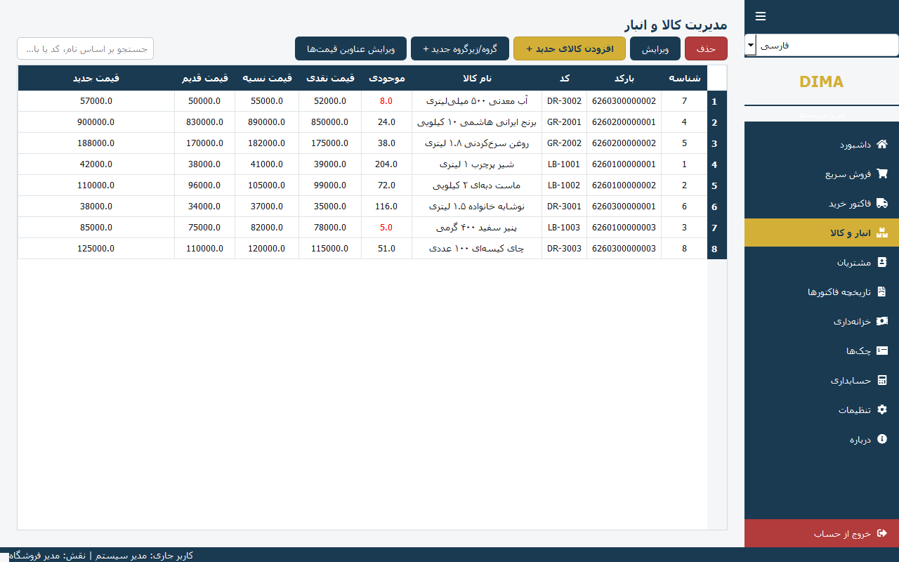 |

| Customers | Treasury |
| --- | --- |
| 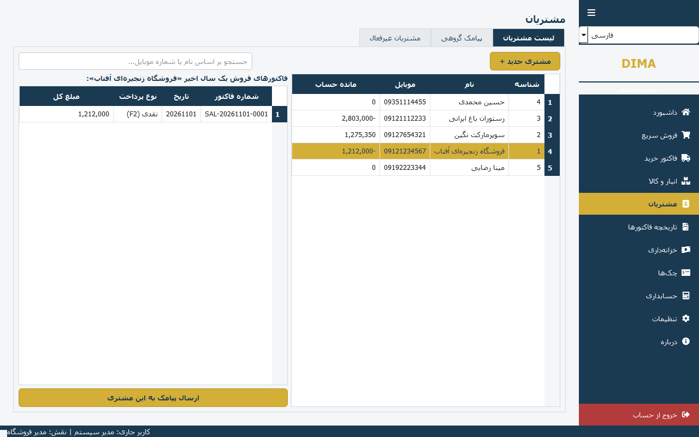 | 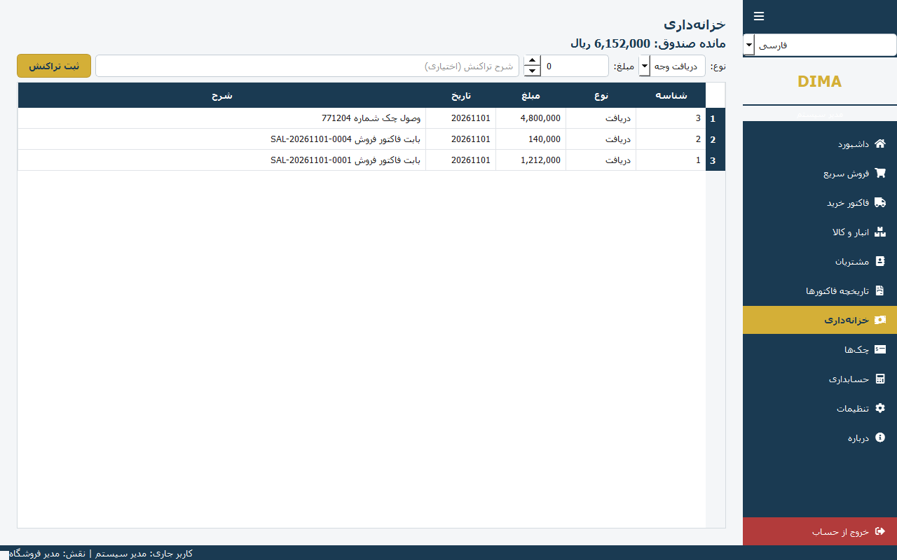 |

| Checks | Accounting |
| --- | --- |
| 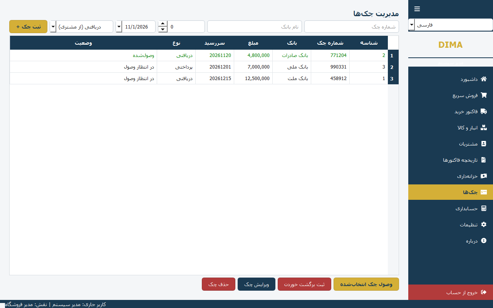 | 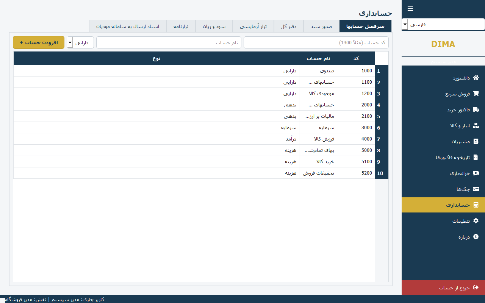 |

| Settings | Login |
| --- | --- |
| 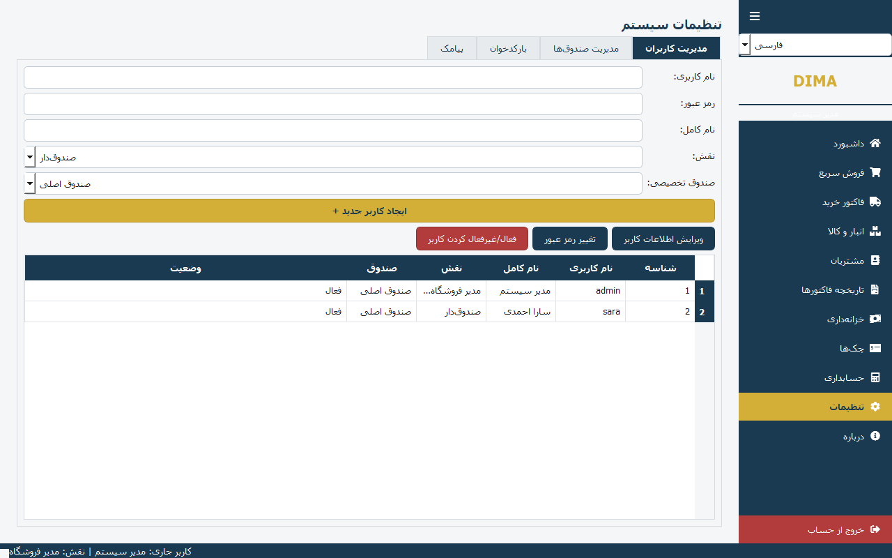 | 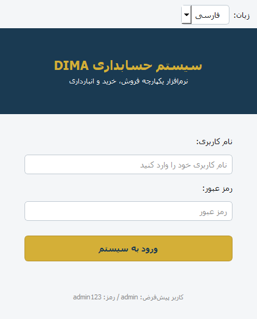 |

The screenshots above are generated from demo data — no real customer or business records are shown.

## Features

**Sales**
- Barcode search, product picker, and a multi-line cart with quantity in units and boxes.
- Four price tiers (cash, credit, old, new) selectable per line.
- Invoice-level discount (amount or percent), line tax, and duty.
- Payment by cash, card, or credit; cash and card receipts are recorded in the selected cash box.
- Invoice history, search, and cancellation with stock and balance restoration.

**Purchases**
- Purchase invoices with numeric/box quantities, free (gift) units, and supplier selection.
- Buy price updates and automatic stock increase.
- Optional tax per line and payable tracking for the supplier.

**Inventory**
- Products with barcode, code, category, unit, units-per-box, and four sell prices.
- Unit conversion, stock adjustment, low-stock highlighting, and search.
- Price-tier labels and categories are stored in the database.

**Customers**
- Customer list and search with balances.
- One-year invoice history per customer.
- Single and bulk SMS to customers through the configured provider.

**Treasury and checks**
- Multiple cash boxes; cashiers are restricted to their own box.
- Receipts, payments, and balance per box.
- Received and issued checks with pending / collected / bounced states.

**Accounting**
- Chart of accounts, account mappings, and manual journal entries with a balance check.
- Automatic postings for sales, purchases, and treasury operations.
- Trial balance, profit & loss, balance sheet, and general ledger with running balance.

**Platform**
- Persian RTL interface with English language option.
- Role-based access: administrator, accountant, and cashier.
- Salted password hashing (PBKDF2-HMAC-SHA256), barcode scanner support, and Modian export records.
- Local SQLite database; no server or network dependency.

## Technology stack

| Layer | Technology |
| --- | --- |
| Language | Python 3.13 |
| Desktop UI | PyQt6, Qt style sheets, qtawesome icons |
| Database | SQLite (single file, foreign keys enabled) |
| Dates | jdatetime (Jalali calendar) |
| Integrations | requests (SMS / Modian), pyserial (barcode scanners) |
| Packaging | PyInstaller, Inno Setup |
| Tests | pytest |

## Download

**Latest Windows release: [DIMA Accounting v1.0.0](https://github.com/OmidDevAi/DIMA-Accounting/releases/tag/v1.0.0)**

1. Open the [Releases page](https://github.com/OmidDevAi/DIMA-Accounting/releases).
2. Download `DIMA_Accounting_Setup.exe` from the release assets.
3. Run the installer on Windows 10 or Windows 11.
4. Launch the application from the Start menu.

The installer is distributed as a GitHub Release asset; it is not stored in the source repository.

## Run from source

### Requirements

- Windows 10 or 11
- Python 3.13 (other recent 3.x versions may work but are not tested)
- Git (optional)

### 1. Clone the repository

```powershell
git clone https://github.com/OmidDevAi/DIMA-Accounting.git
cd DIMA-Accounting
```

### 2. Create and activate a virtual environment

```powershell
py -m venv .venv
.\.venv\Scripts\Activate.ps1
```

### 3. Install dependencies

```powershell
python -m pip install --upgrade pip
pip install -r requirements.txt
```

### 4. Start the application

```powershell
python main.py
```

On first launch the database is created and seeded with a default administrator (`admin` / `admin123`). Change the password before entering real data.

## Tests

The test suite covers the database layer, authentication and roles, inventory, sales, purchases, treasury, checks, accounting reports, invoices, and the remaining modules.

```powershell
pip install -r requirements-dev.txt
pytest
```

Current result on Windows with Python 3.13:

```text
76 passed, 7 xfailed in ~20s
```

The seven `xfail` tests are intentional: each one reproduces a known defect listed under [known limitations](#known-limitations), so the suite stays green while the issue is documented. When a defect is fixed, its test will be marked `xpass` and can be promoted to a regular test.

The tests use isolated temporary databases and never touch your real data.

### Regenerate the screenshots

`tools/capture_screenshots.py` builds a temporary demo database, opens every page off-screen, and writes the PNG files in `docs/screenshots/`:

```powershell
python tools/capture_screenshots.py
```

## Build a Windows executable

The repository includes `DIMA_Accounting.spec` for PyInstaller.

```powershell
pip install pyinstaller
pyinstaller DIMA_Accounting.spec
```

Review the output and paths referenced by the spec file. The build location depends on the PyInstaller configuration.

## Build the Windows installer

The repository includes `installer.iss`, intended for use with **Inno Setup**.

1. Install Inno Setup.
2. Open `installer.iss` in the Inno Setup Compiler.
3. Check that the source and output paths match your build.
4. Compile the installer.
5. Test the installer on a clean Windows environment.

## Project structure

```text
DIMA-Accounting/
├── core/                    # Database, authentication, i18n, shared services
├── modules/                 # Sales, purchase, inventory, customers, treasury,
│                            # checks, accounting, invoices, SMS, Modian
├── ui/                      # PyQt6 windows, pages, dialogs, and style.qss
├── tests/                   # pytest suite with isolated temporary databases
├── tools/                   # Screenshot capture utility and demo data
├── docs/screenshots/        # Application screenshots used in this README
├── main.py                  # Application entry point
├── requirements.txt         # Runtime dependencies
├── requirements-dev.txt     # Runtime + pytest
├── pytest.ini               # Test configuration
├── DIMA_Accounting.spec     # PyInstaller build configuration
├── installer.iss            # Inno Setup installer script
├── DIMA_Icon_2_Minimal.png  # Application icon
└── README.md
```

## Data and security

- Business data is stored in a local SQLite file. Back it up regularly and keep backups secure.
- Never commit database files, credentials, private keys, or customer information to GitHub.
- The default login (`admin` / `admin123`) is for first-run setup only. Change it before real use and do not expose an installation that still uses it.
- Passwords are stored as salted PBKDF2-HMAC-SHA256 hashes, not plain text.
- The application has no network server; SMS and Modian features are the only outbound integrations.
- Test backup and recovery procedures before relying on the software for business-critical records.

## Known limitations

These are confirmed behaviors in version 1.0.0, several of which are reproduced by `xfail` tests:

- **Modian submission is not live.** Records can be prepared and exported; sending to Modian is not implemented.
- **SMS delivery depends on configuration.** Without a configured provider, messages are logged instead of sent.
- **Sales postings do not split COGS or VAT.** The automatic journal entry records the receivable/cash and revenue legs only.
- **Invoice numbering uses `COUNT(*) + 1`.** Deleting an invoice can cause a duplicate invoice number on the next sale.
- **Journal entry numbering counts only the current day.** Backdated entries can collide on the entry number.
- **Deleting an invoice is destructive.** Related treasury rows, journal entries, and the Modian record are removed.
- **Modian quantity ignores units per box.** Numeric and box quantities are added without multiplying by the box size.
- **Single-user local database.** There is no multi-user or client/server mode.

## Integration notes

- **Modian:** preparation and export only; live submission is not implemented.
- **SMS and devices:** availability depends on the provider, hardware, and configuration.
- **Language:** Persian is the primary interface language; an English option is included.

## Contributing

Contributions, bug reports, and suggestions are welcome.

When reporting a bug, include:

- Windows version
- Python version (when running from source)
- Steps to reproduce the issue
- The exact error message, if one appears
- Screenshots with personal or business information removed

Run `pytest` before opening a pull request and keep the suite green.

## Roadmap

- Fix the defects documented by the `xfail` tests (invoice/entry numbering, COGS and VAT postings, Modian quantity).
- Complete and test live Modian submission.
- Document backup and restore procedures.
- Improve translations and document supported languages.

These are possible improvements, not promises about current functionality.

## License

No license has been specified in this repository yet. Until a license is added, do not assume that the code is open for reuse, redistribution, or commercial use.

---

**DIMA Accounting** — Persian-first desktop accounting built with Python, PyQt6, and SQLite.
